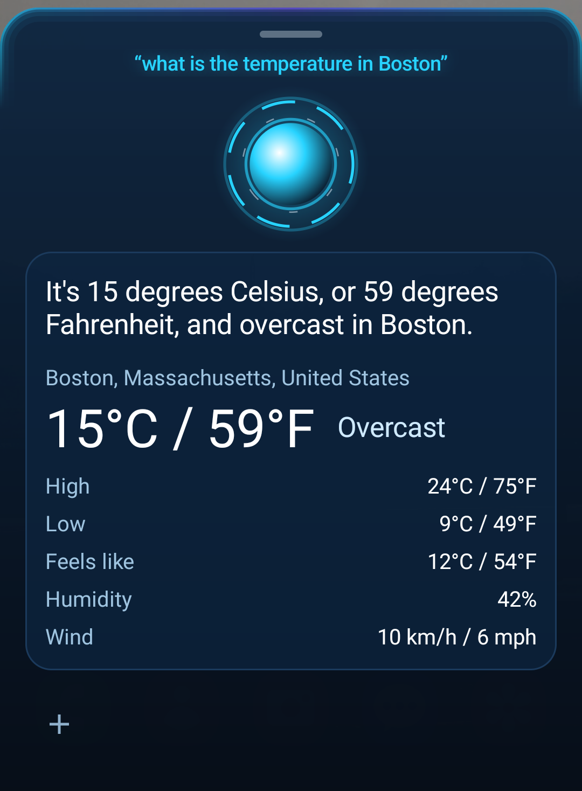
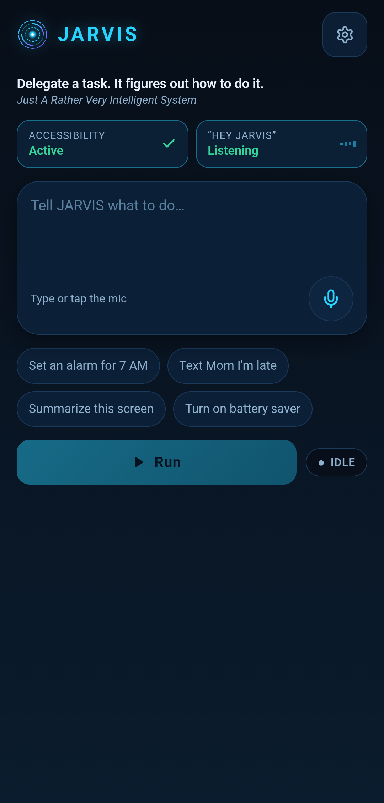

# JARVIS Mobile

**Delegate a task to your phone. It figures out how to do it.**

[](LICENSE) &nbsp; Open source · Android · Built on Meta Muse Spark, Muse Voice Transcribe and SAM 3.1

Siri and Bixby run the commands they were built for. JARVIS takes a goal in plain speech, uses a direct phone
tool when one exists, and otherwise looks at the screen and operates any app itself, one verified step at a time.
Built for the **Meta Global AI Developer Hackathon** (Indie Developer track, theme *Build for Your World*).

> Say "Hey Jarvis, set an alarm for 7 AM and text mummy on WhatsApp that I'm running late." One sentence,
> two actions, both done, one spoken summary.

**Demo video:** _link added at submission_ &nbsp;·&nbsp; **Try it:** see [Try it as a judge](#try-it-as-a-judge)

<p align="center">
  
  &nbsp;&nbsp;
  
</p>

## How Meta's models are used

| Model (Meta Model API) | Role in JARVIS |
|---|---|
| **Muse Spark 1.3** | Reasons about a request and picks tools (alarm, text, call, calendar, weather, ask a question, operate the screen). Also reads screenshots: "summarize this", "add this to my calendar", and each step of the screen-driving agent. |
| **Muse Voice Transcribe 1.0** | Turns the user's speech into text, with an English language hint and app-name keywords. |
| **SAM 3.1** | Finds icon-only buttons by name when the accessibility tree has no usable element. In live scan it also finds the scanned item in the camera view, so the guide can stand on it and follow it. |
| **Muse Image 1.0** | Edited the author's **guide character** design into the mouth shapes and blink that animate it (see [docs/GUIDE_CHARACTER.md](docs/GUIDE_CHARACTER.md)). |

Voice out is ElevenLabs, with the phone's built-in voice as a fallback. Weather is Open-Meteo.

## What it does

| You say | What happens |
|---|---|
| "Hey Jarvis, temperature in Boston" | A card with °C and °F, spoken in full ("16 degrees Celsius, or 61 degrees Fahrenheit…") |
| "Text Mom" (then answers its questions) | Multi-turn: asks the message, then WhatsApp or SMS, then sends |
| "Video call mummy" | Resolves the contact **on the phone** (an exact name beats a partial match: "mummy" is not "badi mummy") and starts a WhatsApp video call |
| "Set an alarm for 7, text Mom I'm late and add dinner at 7 PM tomorrow" | **Mission Mode:** all actions in one request, run in order, shown as a checklist, with one honest summary ("2 of 3 done" if one failed) |
| "Remember Mom is always on WhatsApp" | **On-device memory** you can view, add to and delete in the app, or by voice ("forget Mom") |
| "Summarize this" / "add this to my calendar" / "reply to this saying I'll be late" | **Screen-aware:** the screen is captured at the wake word and sent only when your words point at it |
| "Turn on battery saver", or anything else | **Hidden agent:** operates the screen in the background, reports the result, and can be **stopped at any time** |
| "Scan this" | Asks **Take a photo / Live scan / Choose a photo**. A photo of a resume, sign, label or object is read: one spoken line plus the full details on the card |
| **Live scan** | Full-screen back camera with a caption that updates when the view changes, tap-to-focus, a **Full summary** button, and spoken questions about what the camera sees |
| The **guide** | In live scan, a 3D-style guide (the author's design, animated with Muse Image edits) **pops up from the scanned item**, talks about it with lip-sync and a fun fact, **follows it** as the camera moves, and leaves if the item is gone. A ★ counter tracks discoveries |
| "Who are you?" | JARVIS introduces itself |

There is also an in-app prompt box with a microphone button, a permissions screen with live status, a memory screen,
and a settings screen with Save and Test connection.

If speech-to-text or ElevenLabs fails, or ElevenLabs' daily character budget is spent, the phone falls back to
Samsung/Google speech, so the assistant never goes silent.

## How it works

```
 "Hey Jarvis"  (Vosk wake word, runs on the phone)
        │  captures the screen first, then opens the panel
        ▼
 Panel records speech ──► POST /api/stt ──► Meta Muse Voice Transcribe
        │
        ▼
 POST /api/assistant ──► instant paths (simple alarm, timer, weather, intro: no model call)
        │                or Muse Spark 1.3 with tools
        │      ┌───────────────┼────────────────┬──────────────────┐
        ▼      ▼               ▼                ▼                  ▼
     answer   device action   mission          ask_user          operate_phone
     (+card)  (alarm, SMS,    (several device  (speak a question,  (hidden agent loop)
              WhatsApp, call,  actions in       listen again)
              calendar, …)     order)
                                                        │
        ┌───────────────────────────────────────────────┘
        ▼   observe: screenshot + numbered accessibility tree
   POST /api/phone/step ──► Muse Spark picks ONE action ──► validate ──► safety gate ──► execute ──► repeat
                              tap node │ type │ scroll │ open_app │ tap "<icon description>" ──► SAM 3.1 finds pixels
```

**Design choices that matter**
- **Hybrid perception.** The agent sees the screenshot *and* a numbered accessibility tree, and prefers tapping real elements over guessing coordinates.
- **One action per step, stateless backend.** Every step is independently testable and the server holds no session.
- **Direct tools first.** Alarms, texts, calls and calendar events use Android APIs, which are faster and more reliable than driving the UI. The screen-driving agent is the fallback.
- **Instant paths.** Plain alarms, timers, weather, "open <app>" and the intro skip the model entirely.
- **Verification.** The agent may only report `done` if it can cite evidence on the current screen. Mission Mode reports what actually failed instead of claiming success.
- **Contacts never leave the phone.** The model sees the name you said; matching happens on the device.

## Safety and privacy

- Consequential taps (pay, send, delete, order, call…) need on-device **Allow / Deny**. A generic "Confirm" or "Continue" is also gated when the screen shows money, a recipient or a deletion, and the prompt quotes what is on screen.
- Before acting, the phone checks the target element still exists and the foreground app is unchanged ("stale element" protection).
- **Stop** cancels the in-flight model request and the next action, from the pill or the app.
- A screenshot is sent **only** when your words point at the screen ("this", "here", "reply"). It lives in memory for 90 seconds and is cleared when the panel closes.
- A camera photo or live-scan frame is sent to Meta **only when you scan**, is never saved, and the temporary photo file is deleted. JARVIS **never identifies a real person** from their face or appearance (enforced in the prompt and tested); people are described generically and are never given a location for the guide.
- Memory is stored only on the phone.
- API keys live on the server; the app holds a device token. App backups are disabled and the server rate-limits each client.
- The standard `muse-spark-1.3` model is used, **not** the `-contributor` tier (that tier trains on inputs, including screenshots).

## SAM 3.1 grounding: honest results

When no listed element fits (icon-only buttons, canvas or custom UIs), Muse Spark names the target ("three dots icon") and
SAM 3.1 returns its pixel box. I benchmarked this on 17 targets from 3 screens of one Samsung phone (home screen, Clock,
app drawer) against accessibility-tree ground truth, tapping from the screenshot alone:

| Approach | Correct taps |
|---|---|
| Muse Spark guesses coordinates | 9 / 17 |
| Muse Spark names target + SAM 3.1 locates it | 6 / 17 |

SAM won the **icon-only** targets (plus, three-dots, close, phone icon: 4 of 4, where coordinate guessing got 0 of 4) and
lost on labeled folders and apps, where it sometimes picked the wrong match. So SAM is used **only as a fallback** when the
accessibility tree has no usable element. It is a small sample on one device: a signal, not a claim. Reproduce with
`backend/bench/grounding_bench.py`.

## Built during the hackathon

This repository was started on **Nov 2, 2026** (see the commit history) and everything in it was written during the
hackathon: the backend, the Android app and native services, the wake word, the panel and screens, Mission Mode, memory,
screen awareness, the camera scan and live scan, the animated guide (the author's character design, its expressions generated with Muse Image), the safety gate, SAM grounding and the benchmark, and the deployment. It does not use code from the
author's earlier desktop assistant, which is a separate project. Third-party libraries, models and services are listed in
[THIRD_PARTY_NOTICES.md](THIRD_PARTY_NOTICES.md). The visual design was drafted with Google AI Studio and re-implemented here.

## Try it as a judge

1. On an Android phone, download `jarvis-mobile.apk` from the latest [release](../../releases) and install it (allow "Install unknown apps" for your browser or Files app).
2. Open JARVIS, tap ⚙, paste the **device token** from the submission's testing instructions, and tap **Save changes** then **Test connection**. The backend is already set to the hosted service; the first request after a quiet period can take about 30 seconds.
3. Turn on **Accessibility → JARVIS** (the app's Fix button opens the right screen), tap **Turn on "Hey Jarvis"**, and allow microphone, contacts, SMS, calendar and "display over other apps".
4. Say **"Hey Jarvis, temperature in Boston"**. Then try the mission example above, or tap the mic in the app and say "open the clock app".
5. Tap **● Live scan** on the home screen (allow the camera), point at a single object on a plain surface, and wait a few seconds for the guide to pop up and talk. Tap the screen to focus; move the camera and the guide follows.

## Run it yourself

**Backend**
```bash
cd backend && python3 -m venv .venv && .venv/bin/pip install -r requirements.txt
cp .env.example .env     # META_API_KEY, JARVIS_DEVICE_TOKEN; ELEVENLABS_* optional
.venv/bin/python app.py  # http://localhost:5050
.venv/bin/python -m pytest tests -q   # 37 tests
```

**Android app** (Node 22 is fetched via `npx`, JDK 17+, Android SDK 36)
```bash
bash scripts/fetch-wake-model.sh      # downloads the 68 MB Vosk model (not in git)
cd app && npm install && cp .env.example .env   # set VITE_DEFAULT_BACKEND (and a token for your own builds)
npm run build && npx -y node@22 node_modules/@capacitor/cli/bin/capacitor sync android
cd android && ./gradlew assembleDebug
adb install -r app/build/outputs/apk/debug/app-debug.apk
adb reverse tcp:5050 tcp:5050         # only for a laptop backend over USB
```

**Deploy the backend** (Render): New → Blueprint → this repo (`render.yaml`). Enter `META_API_KEY`, `JARVIS_DEVICE_TOKEN`,
`ELEVENLABS_API_KEY`, `ELEVENLABS_VOICE_ID` in the dashboard. A scheduled GitHub Action pings `/api/health` every 10 minutes
to keep the free tier awake.

## Repo layout

```
backend/   Flask API: assistant.py (router, tools, instant paths), phone_agent.py (screen agent, safety gate),
           sam_grounding.py, vision.py (live scan and guide), speech.py (STT/TTS), tests/, bench/
app/       React + Capacitor app (src/screens), android/ holds the native services:
           WakeWordService, AssistActivity (panel), ArcReactorOrbView, SheetDrawable, JarvisAccessibilityService,
           AgentRunner, StatusOverlay, DeviceActions, ContactMatcher, Memory, ScreenContext,
           LiveScanActivity (CameraX), GuideView (sprite guide)
scripts/   fetch-wake-model.sh, build_guide_sprites.py (builds the guide from the character art and its Muse Image edits)
docs/      DEMO.md (demo script), GUIDE_CHARACTER.md (how the guide was made), screenshots/
```

## Known limits

- **Accessibility-based control** is powerful and would face Google Play policy review; this is a sideloaded APK for the hackathon, not a store release.
- **One shared device token.** There are no per-user accounts yet; a per-client rate limit protects spend.
- **Server-side inference.** Reasoning and vision run on Meta's API; only the wake word runs on the device.
- WhatsApp sending relies on its on-screen layout and may need adjusting after app updates.
- The wake word can still mishear background speech (confidence is logged under `JarvisWake` for tuning), and speech-to-text occasionally repeats the end of a sentence.
- **Live scan is "live" at a few-second rhythm**, not video: each look is a still frame sent to Meta's vision model (about 2 to 4 seconds), only when the view changes, and a session is capped. It needs decent light, and the guide can lose a fast-moving item.
- The guide is a 2.5D character (generated art with swapped face patches and code-driven motion), not a rigged 3D model; Meta's API has no 3D generation.
- Tested on one Samsung phone. Hidden-agent success on arbitrary apps is not benchmarked yet.

## License

[MIT](LICENSE). Third-party notices: [THIRD_PARTY_NOTICES.md](THIRD_PARTY_NOTICES.md).
